# CORE Pulse — Architecture

```mermaid
flowchart LR
  subgraph SIM["1. Source Simulation (source_sim.*)"]
    S1["Admin.BusinessUnit\nProject / Service / Phase / Task"]
    S2["OP.ApplicationLog / APPUser\nTimesheet.Timecard / Row / Entry\nExpense.ExpenseReport / Entry"]
  end

  subgraph BRZ["2. Bronze Layer (bronze.core_*)"]
    B1["16 Source-Aligned Tables\n+ SourceExtractDateTime, PipelineRunId\n+ ApplicationLogId Watermark"]
  end

  subgraph SLV["3. Silver Layer (silver.*)"]
    SV1["organization (LEFT JOIN enrichment)\napplication_mapping (CONFIRMED/REVIEW/EXCLUDED)"]
    SV2["project · task_activity\nlogin_activity (IsServiceAccount=0)\ntimecard · expense_report"]
  end

  subgraph GLD["4. Gold & Certified Layer (gold.* / goldview.*)"]
    G1["gold.coreadoption_kpi_daily\ngold.coreadoption_user_activity\ngold.coreadoption_event"]
    GV["goldview.v_core_adoption\n(CURRENT & MONTHLY · OVERALL / WAVE / ENTITY / BU)\n+ reference.rollout_registry (SIMULATED EXTENSION)"]
  end

  subgraph SEM["5. Governed Semantic, RLS & MCP Layer"]
    SM["metrics.yaml + Python Query Service\n+ SQL Server SESSION_CONTEXT RLS\n+ Read-Only MCP Server (mcp_server/)"]
  end

  subgraph UI["6. Conversational AI & BI Consumers"]
    ST["CORE Pulse Streamlit App\n(Chat · Rollout Explorer · Data Catalog · Guide · About)"]
    LLM["LiteLLM (Ollama gpt-oss:20b / qwen2.5-coder:14b / rules)\n+ Numeric & Non-Additivity Guardrail"]
    BI["Tableau · Power BI · Connected Excel"]
  end

  SIM --> BRZ --> SLV --> G1 --> GV --> SM
  SM --> ST
  ST <--> LLM
  GV --> BI
```

## Key Security & Governance Boundaries

1. **Zero LLM SQL Generation or Arithmetic:** The LLM selects one of 10 typed read-only tools and writes a concise narrative strictly from structured facts. A numeric and non-additivity guardrail verifies every figure and blocks summing distinct employee counts across waves, entities, or months.
2. **Dual Row-Level Security:** SQL Server enforces `rls.fn_core_access` via `SESSION_CONTEXT('user_id')` under the read-only `pulse_reader` login; the Python semantic service enforces identical scope rules on both SQL Server and DuckDB.
3. **DataOps Idempotency & Explicit Inserts:** `pipelines/medallion.py` stages extracts, enforces explicit target column lists on every permanent insert, logs step runs and quality checks in `dataops.*`, and advances the `ApplicationLogId` watermark only after commit.
