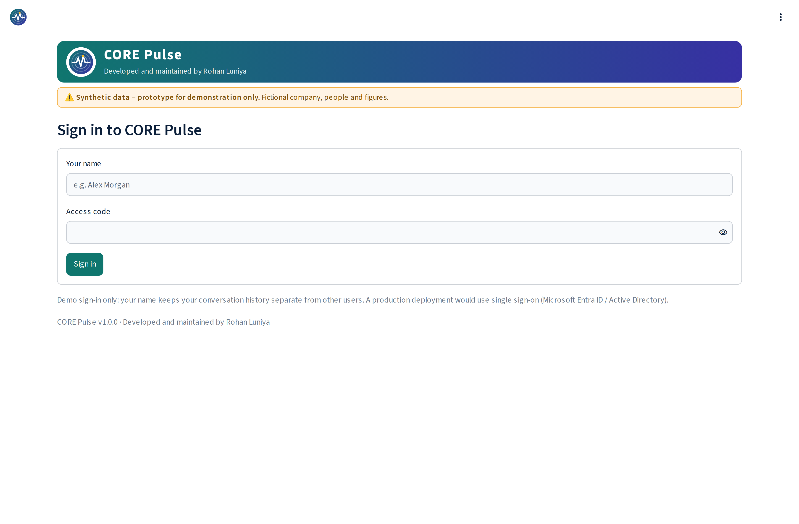
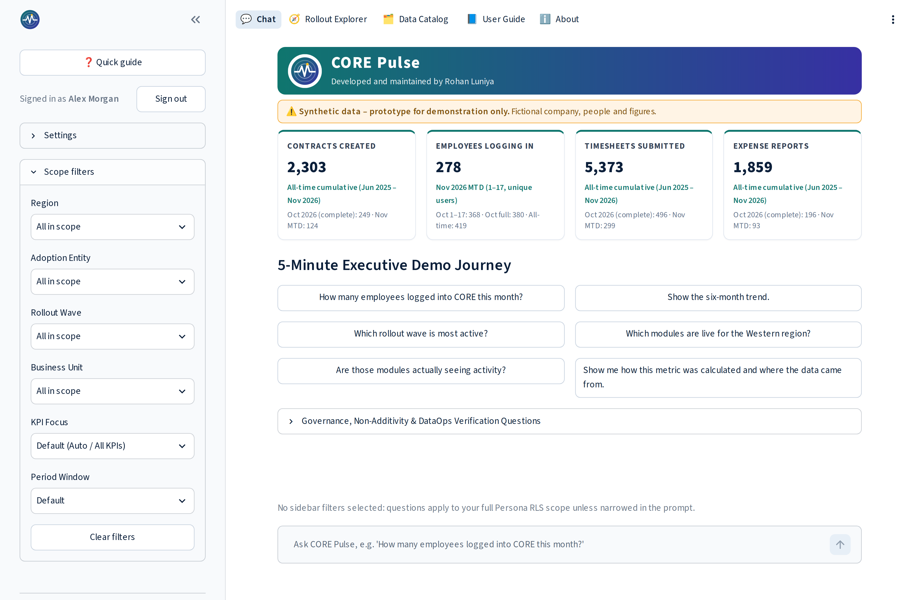
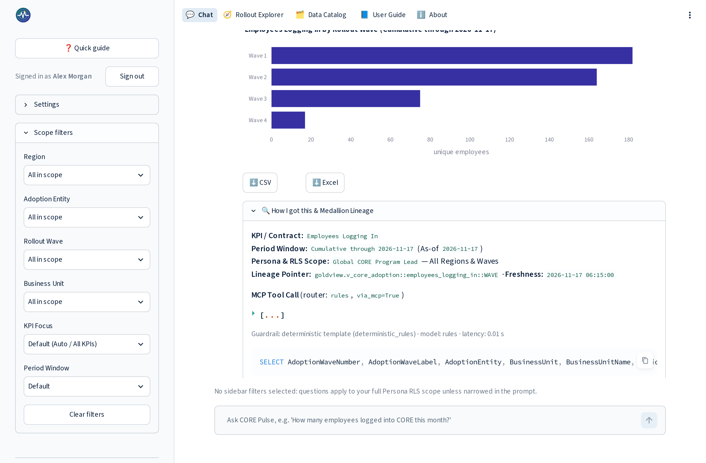
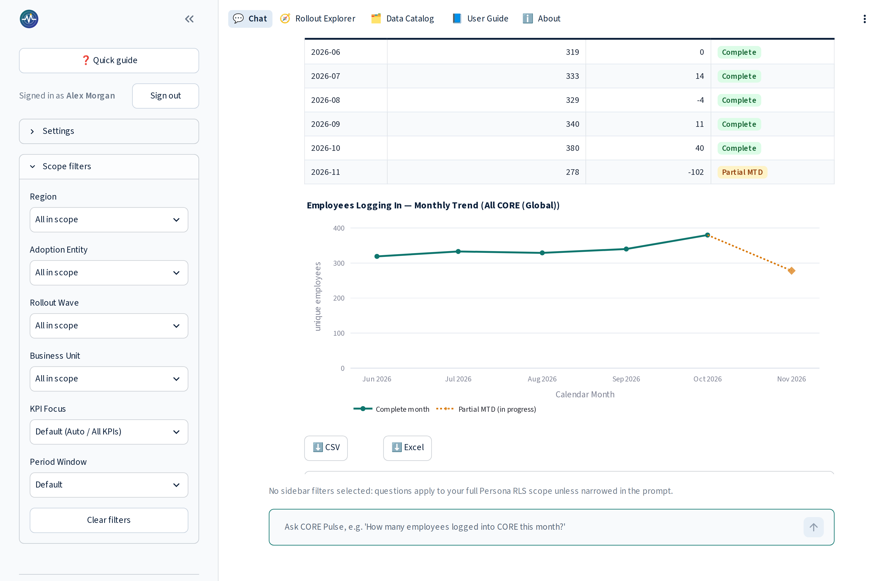
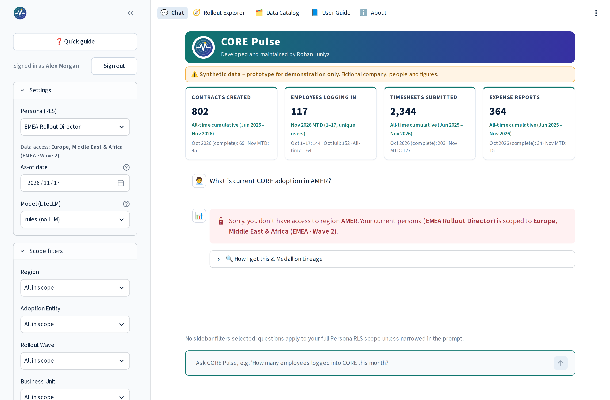
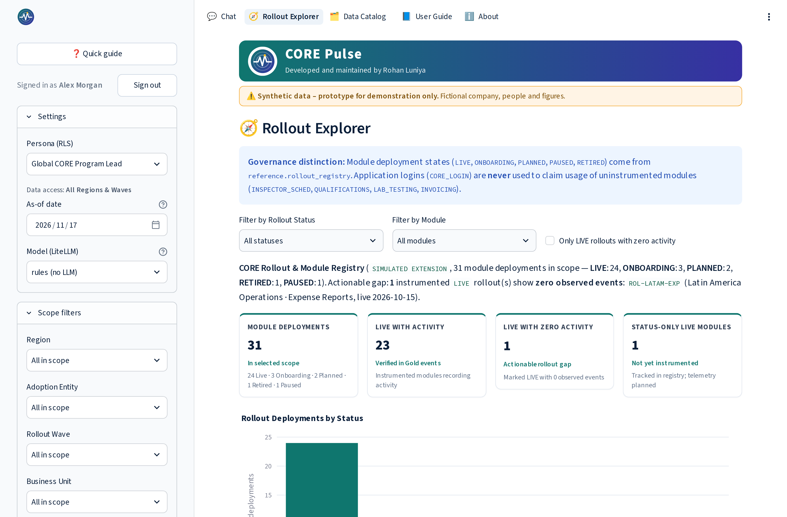
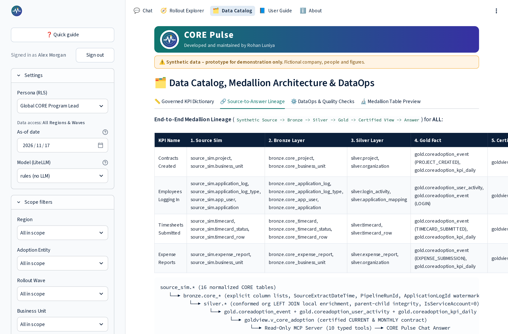

# CORE Pulse — User Guide

**CORE Pulse** gives program leaders, regional operations VPs, and business intelligence teams a single governed interface to track global rollout progress and true operational adoption across the **CORE** platform.

> **Synthetic data – prototype for demonstration only.** Fictional company, people and figures.

---

## 1. Signing In & Personal Conversation Memory

Sign in with your display name and the shared demo access code. Your display name keeps your **last 10 conversations** (including pinned threads, saved scope filters, and multi-turn context) separate from other users.

---

## 2. Executive KPI Strip & Conversational Analytics

At the top of **Chat**, four certified KPI cards summarize `goldview.v_core_adoption` with explicit time-window labels so cumulative totals, complete months (`Oct 2026`), and partial month-to-date (`Nov 2026 MTD`) figures are never mixed up:

| Certified KPI | Counting Formula | Event Timestamp | Supported Grains |
|---|---|---|---|
| **Contracts Created** | `COUNT(DISTINCT ProjectId)` | `Project.CreatedDate` | `OVERALL`, `WAVE`, `ENTITY`, `BUSINESS_UNIT` |
| **Employees Logging In** | `COUNT(DISTINCT APPUserId)` (`IsServiceAccount = 0`) | `ApplicationLog.CreatedDate` | `OVERALL`, `WAVE`, `ENTITY` *(Strictly non-additive)* |
| **Timesheets Submitted** | `COUNT(DISTINCT TimecardId)` (`SubmittedDate IS NOT NULL`) | `Timecard.SubmittedDate` | `OVERALL`, `WAVE`, `ENTITY` |
| **Expense Reports** | `COUNT(DISTINCT ExpenseReportId)` (`SubmittedDate IS NOT NULL`) | `ExpenseReport.SubmittedDate` | `OVERALL`, `WAVE`, `ENTITY`, `BUSINESS_UNIT` |

---

## 3. Multi-Turn Context, Charts & Non-Additive Distinct Counts

Ask follow-up questions naturally:
- *"How many employees logged into CORE this month?"*
- *"Show the six-month trend."*
- *"Which rollout wave is most active?"*

CORE Pulse carries forward the active KPI, scope, and period automatically. Whenever `Employees Logging In` is broken down across waves, entities, or applications, CORE Pulse displays the **true deduplicated `OVERALL` total** alongside child rows so cross-wave users are never double-counted.

---

## 4. Persona Row-Level Security (RLS) & Cascading Scope Filters

Open **Settings** in the left sidebar to switch between three governed personas:
- **Global CORE Program Lead:** Full global access (`AMER`, `EMEA`, `APAC`, Waves 1–4).
- **Americas Operations VP:** Scoped to `AMER` (`North America Field Ops`, `North America Cert & Labs`, `Latin America Operations`, Waves 1 & 4).
- **EMEA Rollout Director:** Scoped to `EMEA` (`Europe Industrial & Testing`, `MEA Energy & Marine`, Wave 2).

On SQL Server 2022 (`core_pulse`), Row-Level Security is enforced natively in the database engine via `SESSION_CONTEXT('user_id')`. Unsupported breakdowns (such as `Employees Logging In` or `Timesheets Submitted` by Business Unit) return clear governance explanations rather than fabricated numbers.

---

## 5. Rollout Explorer (`SIMULATED EXTENSION`)

Switch to **🧭 Rollout Explorer** in the top bar to compare planned vs. actual go-live status (`reference.rollout_registry`) against observed activity in `gold.coreadoption_event`:
- Distinguishes **Instrumented** modules (`CORE_LOGIN`, `PROJECTS`, `TIMECARDS`, `EXPENSES`) from **Status-Only / Not Instrumented** modules (`INSPECTOR_SCHED`, `QUALIFICATIONS`, `LAB_TESTING`, `INVOICING`).
- Highlights **`LIVE — ZERO observed events`** deployments immediately (such as `ROL-LATAM-EXP` in Latin America Operations).

---

## 6. Data Catalog, Medallion Lineage & DataOps Watermarks

Open **🗂️ Data Catalog** or expand **🔍 How I got this & Medallion Lineage** under any chat answer to inspect:
- **End-to-End Lineage:** `source_sim.*` → `bronze.core_*` → `silver.*` → `gold.*` → `goldview.v_core_adoption` → MCP Tool → Answer.
- **DataOps Telemetry:** Pipeline run status, incremental `ApplicationLogId` high-water mark (`dataops.watermark`), orphan quarantine metrics, and source-to-Gold parity checks.
- **Exports:** Download any answer table as **CSV** or **Excel (`.xlsx`)**.
